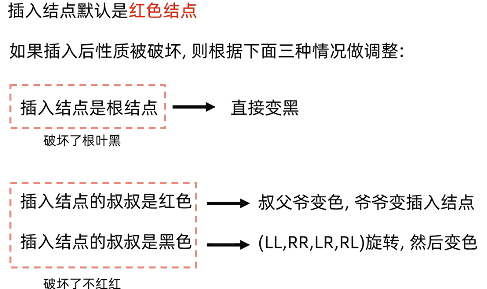
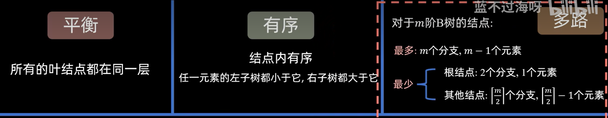
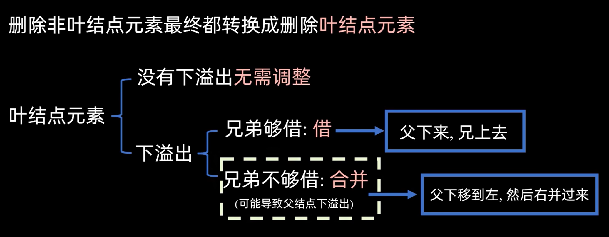
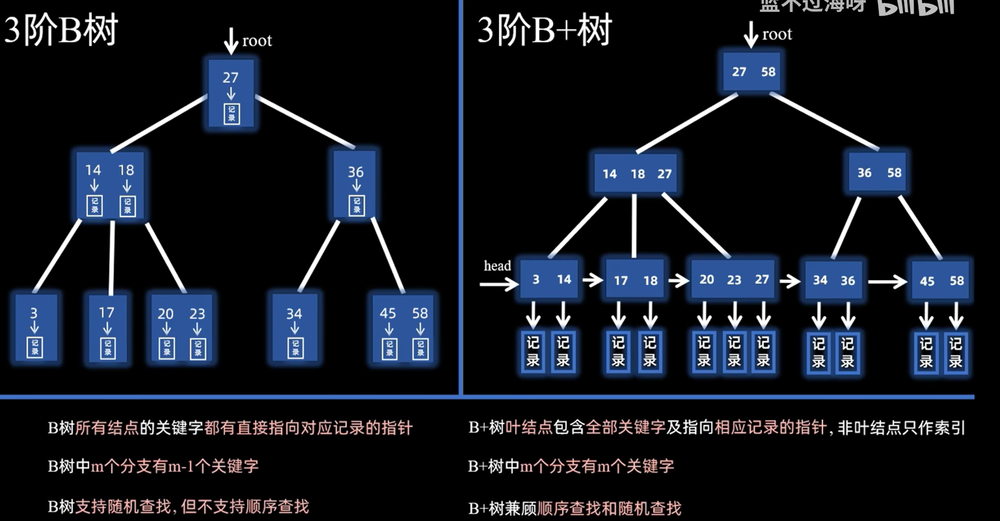

## 红黑树
### 定义：
左根右：二叉搜索树（左<根<右）
根叶黑：根和叶子（NULL）都是黑色
不红红：不存在连续的两个红色结点
黑路同：任一结点到叶所有路径黑结点数量相同

高度：最长路径不超过最短路径的两倍，任一结点左右子树的高度相差不超过两倍
### 插入：

## b树

三个特点：

删除操作：

### 构建：
就是一堆点，一个个插入，然后一直向上形成根，新的根的过程
### 插入：

## b+树
他主要用于数据库的查询，只有叶子节点是用来指向索引的，别的节点都是指向索引的索引，
具体看 辨析内容
## b树 b+树辨析

## B数，m阶，高度h，关键字n的关系

1.关键字最多，高度最少
$$h \ge \log_m(n + 1)$$
2.关键字最少高度最多：
$$n_{\min} = 2 \times \lceil m/2 \rceil^{h-1} - 1$$
### 一、 核心物理规则（就两点）
对于 $m$ 阶 B 树：
1. **每个结点能装多少关键字？**
    - **上限：** 最多包含 $m - 1$ 个关键字。
    - **下限：** 除根结点外，非叶节点最少包含 $\lceil m/2 \rceil - 1$ 个关键字。
根节点最少是一个

把 B树（$m$ 阶、高度 $h$、关键字个数 $n$）的核心关系和极值公式梳理如下，方便你快速记忆和推导。
### 一、 核心概念与“1纪律”
记住这个最根本的铁律，所有公式都能当场推导：
$$\text{某个节点的子树（孩子）个数} = \text{该节点的关键字个数} + 1$$

| **概念**               | **含义与符号**                        | **限制规则（根节点特殊，其他节点统一）**                     |
| ---------------------- | ------------------------------------- | ------------------------------------------------------------ |
| **阶数 $m$**           | 树中节点允许的**最多子树/孩子个数**   | 决定整棵树的上限。                                           |
| **关键字个数 $k$**     | 节点内部保存的数据个数                | **根节点**： $1 \le k \le m - 1$   **非根非叶节点**： $\lceil m/2 \rceil - 1 \le k \le m - 1$ |
| **子树/孩子个数 $c$**  | 节点延伸出的分支数                    | **根节点**： $2 \le c \le m$ （当树非空时）   **非根非叶节点**： $\lceil m/2 \rceil \le c \le m$ |
| **叶结点（失败节点）** | 最底层的外部节点（不带信息，即 NULL） | **总叶结点数** $= n + 1$ （$n$ 为关键字总数）                |
### 二、 高度 $h$ 与关键字个数 $n$ 的极端关系
考研数据结构中最常考的就是：**给定 $h$，求 $n$ 的范围**，或者**给定 $n$，求 $h$ 的范围**。
> **注意**：考研大纲一般将**最底层的外部节点（失败节点）算作第 $h+1$ 层**。以下推导均以“根节点为第 1 层，第 $h$ 层为最底层含信息的非叶节点，第 $h+1$ 层为叶结点”为例。
#### 1. 尽可能“胖”（节点全装满 $\to$ 关键字最多 / 高度最小）
- **条件**：每个节点都拥有最大的 $m$ 个分支（即 $m-1$ 个关键字）。
- **推导**：
- 第 1 层：1 个节点，含 $m-1$ 个关键字
- 第 2 层：$m$ 个节点，含 $m(m-1)$ 个关键字
- ...
- 第 $h$ 层：$m^{h-1}$ 个节点，含 $m^{h-1}(m-1)$ 个关键字
- **总结公式**：
​
$$\text{关键字总数上限 } n_{\max} = m^h - 1$$
- **反推高度下限**：
​
$$h \ge \log_m(n + 1)$$
​
#### 2. 尽可能“瘦”（节点吃半饱 $\to$ 关键字最少 / 高度最大）
- **条件**：根节点只给 2 个分支（1 个关键字）；其余节点都只给最少的 $\lceil m/2 \rceil$ 个分支（即 $\lceil m/2 \rceil - 1$ 个关键字）。
​
- **推导**：
- 第  1层：1 个节点，1 个关键字
- 第 2 层：2 个节点
- 第 3 层：$2 \times \lceil m/2 \rceil$ 个节点
​
- ...
​
- 第 $h$ 层：$2 \times \lceil m/2 \rceil^{h-2}$ 个节点
- 第 $h+1$ 层（叶结点层/失败节点）：共 $2 \times \lceil m/2 \rceil^{h-1}$ 个叶结点
- **总结公式**：
- **最少关键字数**：
​
$$n_{\min} = 2 \times \lceil m/2 \rceil^{h-1} - 1$$
- **用叶结点数推导（更直观）**：因为 $n$ 个关键字对应 $n+1$ 个叶结点，而第 $h+1$ 层叶结点数最少为 $2 \times \lceil m/2 \rceil^{h-1}$，所以：
​
$$n + 1 \ge 2 \times \lceil m/2 \rceil^{h-1}$$
- **反推高度上限**：
​
$$h \le \log_{\lceil m/2 \rceil} \left( \frac{n + 1}{2} \right) + 1$$
### 三、 一张表搞定极值范围
| **状态**           | **条件**                         | **关键字总数 n 与 高度 h 的关系**                                                                                   | **解题记忆口诀**                                 |
| ---------------- | ------------------------------ | -------------------------------------------------------------------------------------------------------- | ------------------------------------------ |
| **最多关键字 / 最矮高度** | 节点全满 ($c = m$)                 | $n \le m^h - 1 \implies \mathbf{h \ge \log_m(n+1)}$                                                      | 满 $m$ 叉树，按满二叉树公式类比 ($2^h - 1 \to m^h - 1$) |
| **最少关键字 / 最高高度** | 节点半满 ($c = \lceil m/2 \rceil$) | $n \ge 2\lceil m/2 \rceil^{h-1} - 1 \implies \mathbf{h \le \log_{\lceil m/2 \rceil}(\frac{n+1}{2}) + 1}$ | 根节点分 2 叉，后续节点全分 $\lceil m/2 \rceil$ 叉      |

## 查找失败的平均查找长度
### 一、 核心计算公式
$$\text{ASL}_{\text{fail}} = \frac{\sum_{i=0}^{p-1} \text{从入口 } i \text{ 出发找到第一个空位置的比较次数}}{p}$$
* **分子**：从每一个**可能的哈希映射入口**出发，按照冲突处理方法（如线性探测）依次向后检查，直到遇到**第一个空位置**止，所比较的次数之和。
* **分母 $p$**：**哈希函数的模数**（即可能产生的哈希入口地址总数，如 $H(\text{key}) = \text{key} \pmod p$ 中的 $p$）。
---
### 二、 标准求解三步法
以**线性探测法**（如 $H(\text{key}) = \text{key} \pmod p$）为例：
#### 第一步：模拟建表
1. 依据哈希函数 $H(\text{key})$ 计算每个关键字的初始位置。
2. 若发生冲突，按线性探测规则依次向后寻找空位，将所有给定的关键字填入哈希表中。
#### 第二步：计算各入口的比较次数
1. 确定所有**可能的入口地址**（即 $0 \sim p-1$，共 $p$ 个起点）。
2. 从起点 $i$ 开始向后数，检查经过了多少个非空结点，直到撞见第一个“空”停止。
3. **记步规则**：起点算第 1 次，每往后移一位加 1 次，直到踩到空位置（空位置本身也算作最后一次比较）。
#### 第三步：求平均值
1. 将 $0 \sim p-1$ 这 $p$ 个起点算出的比较次数全部相加。
2. **除以 $p$**（注意：分母永远是哈希函数的**模数 $p$**，而不是哈希表的总长度 $m$，更不是表中的空位数）。
---
### 三、 避坑要点（易错点）
1. **分母是模数 $p$，不是表长 $m$**：
* 即使哈希表长度为 11，如果哈希函数是 $\text{key} \pmod 7$，任意未知 key 算出的初始落脚点只能是 $0 \sim 6$，所以**分母固定为 7**。
2. **遇空即停**：
* 查找失败的本质是“证明该数不存在”。只要看到**空位置**，就说明该数不可能存在于表中，查找立即终止。
3. **循环回绕（注意边界）**：
* 若向后探测到哈希表末尾仍未遇到空位置，探针会**循环绕回下标 0** 继续向后查找，直到撞见空位。

### 通俗化表达：
1.首先给题目给的数字按照罗卜填坑写进去
2.然后从每一个入口出发，计算每一个入口到第一个空位需要的长度，然后累加除以mod长

## 查找成功的平均查找长度
1.首先给题目给的数字都填进去
2.然后就按照题目给的算法找，第一个计算找到了就是1次，如果往后n次找到了就是n+1次

## 散列方法的各概念意思
1.$$\text{存储效率} = \text{装填因子 } \alpha = \frac{\text{表中填入的元素个数}}{\text{哈希表的总长度}}$$是在装入前就固定好的
2.$$\text{装填因子 } \alpha = \frac{\text{表中填入的元素个数 } n}{\text{哈希表的总长度 } M}$$
装填因子是**衡量空间利用率与查找效率之间平衡**的核心指标